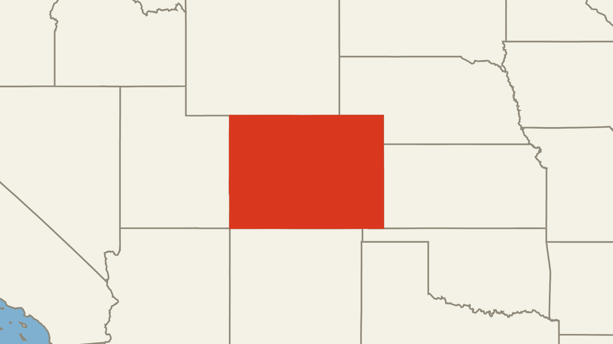
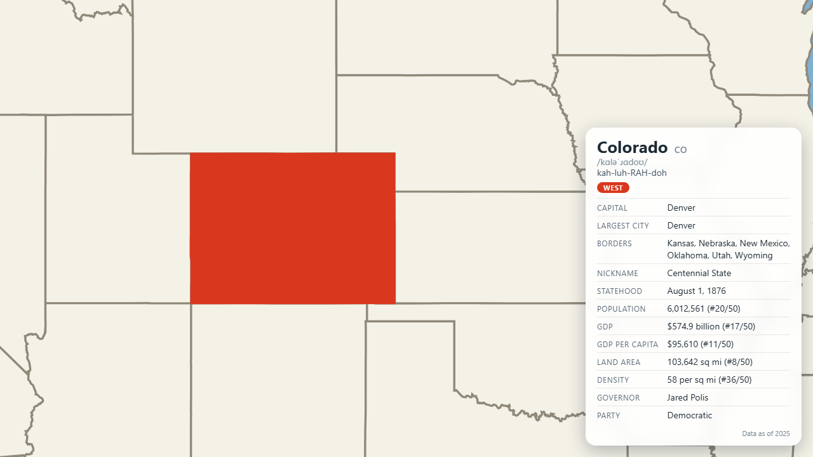
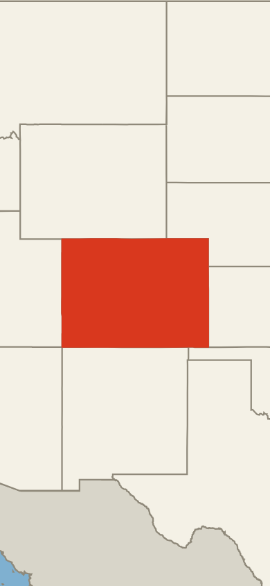
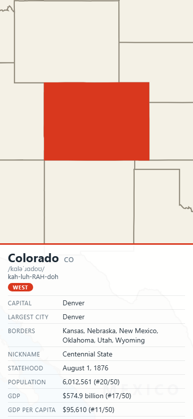
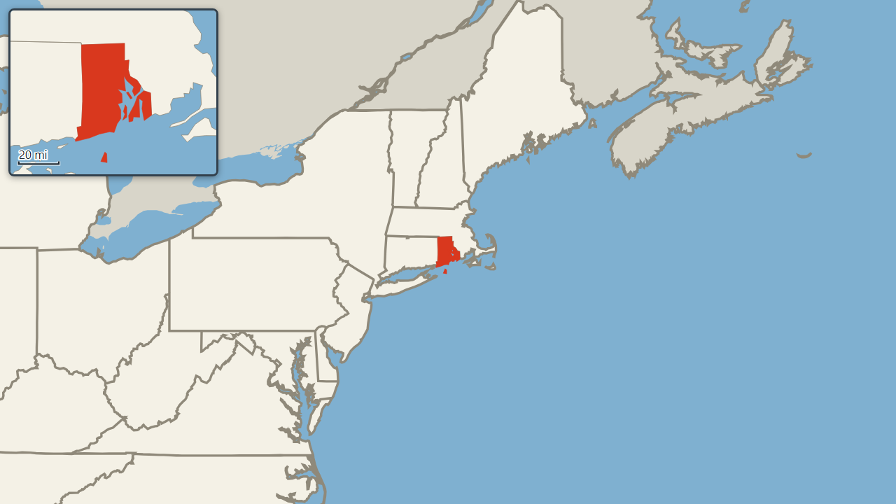
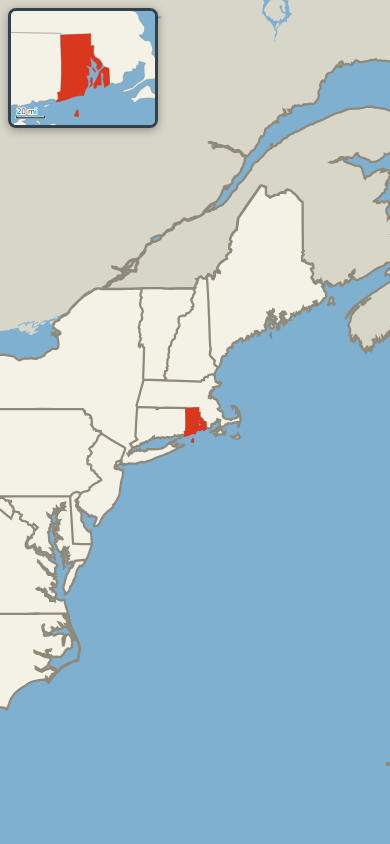

# 🌎 Studying the US Map

[](https://github.com/jackindisguise/studying-the-us-map/releases/latest)    [](https://ankiweb.net/shared/info/2063358034) 

**An Anki deck for learning where every U.S. state is, and a few facts about each.**
This project holds everything needed to generate the deck's data, maps and package.

---

## The deck

- **States:** the 50 states, without Washington, D.C. or the territories (`data/states.json`).
- **Notes:** one *State Map* note per state, keyed by its postal code (`US-CO`), most populous first.
- **Cards:** one per note. *Locate* shows a map with the state highlighted and asks which state it is.
- **Back of the card:** name, abbreviation, region, capital, largest city, bordering states and countries, nickname, statehood date, population, GDP, GDP per capita, land area, density, governor, party and the year of the data. Under the name is its pronunciation, as IPA and a plain-English respelling. Empty rows are hidden.
- **Sub-decks:** one per Census region (Northeast, South, Midwest, West).
- **Maps:** one SVG per state, a north-up Mercator view, with the state in red, the other states in cream and other countries in grey. Alaska and Hawaii use wider views.
- **Zoom boxes:** states with under 5,000 square miles of land (Connecticut, Delaware and Rhode Island) also get a zoomed-in box (`us-zoom-<state>.svg`) pinned to the top-left of the card, with a scale bar.
- **Flags:** not included yet; they are planned as their own sub-decks.

---

## Examples

Screenshots rendered from the card templates with `node scripts/build-examples.js`.

### Desktop

**Locate** (Colorado): find the red state, then flip for its facts.

<table>
<tr><td align="center">Front</td><td align="center">Back</td></tr>
<tr><td></td><td></td></tr>
</table>

On the back, the map shifts to the middle of the space beside the details card, so the state isn't hidden behind it.

### Phone

The map fills the screen, and on the back it shifts up into the middle of the area above the details panel.

<table>
<tr><td align="center">Locate front</td><td align="center">Locate back</td></tr>
<tr><td></td><td></td></tr>
</table>

### Tiny states

States with very little land (here Rhode Island) also get a zoomed-in box in the top-left corner, with a scale bar.

<table>
<tr><td align="center">Desktop</td><td align="center">Phone</td></tr>
<tr><td></td><td></td></tr>
</table>

---

## What this project does

- **Collects the data:** takes population from the U.S. Census Bureau, GDP from the Bureau of Economic Analysis and the other facts from Wikipedia, and writes one record per state to `data/records.json`. Each numeric value (population, GDP, GDP per capita, land area, density) carries its rank among the 50 states, as `6,012,561 (#20/50)`; 1 is the highest and ties share a rank.
- **Adds pronunciation:** takes the US English IPA of each state name from Wiktionary and generates a plain-English respelling from it, with the same key for every state (`data/pronunciation.json`).
- **Draws the maps:** renders every state's map SVG, and the zoom boxes, into `build/media/`.
- **Writes the note file:** a single Anki-importable CSV, `build/notes.csv`, with one row per state. It has import headers (note type, deck and tags columns); the Map field holds `` tags that point at the files in `build/media/`, named `us-map-<state>.svg` and `us-zoom-<state>.svg`. Import that folder's files into Anki's media folder as they are.
- **Builds the package:** bundles the notes, media and card template into an `.apkg`, with a description on each deck.
- **Makes example images:** renders card screenshots into `docs/images/` for this page and the AnkiWeb page (`docs/ankiweb.md`). It needs Edge or Chrome and a rendered `build/media`.
- **Keeps the card design:** stores the Anki card template and CSS in `templates/`.

---

## Layout

- `scripts/`: data pipeline and map renderer (run everything from the package root).
- `data/`: committed inputs, which are the state list, the deck descriptions, cached Census/BEA/Natural Earth/Wikipedia/Wiktionary sources (`data/raw`) and the derived JSON (`pronunciation`, `records`).
- `templates/`: the Anki card template for the *State Map* note type, in `templates/locate/` (`front.html`, `back.html` and `style.css`).
- `docs/`: the AnkiWeb page (`ankiweb.md`) and the example images.
- `build/`: generated output, including `build/media/`, `build/notes.csv`, `build/fit/boxes.json` and the `.apkg`.

---

## Usage

Requires Node.js 22.12 or newer (developed on Node 26).

```
npm install
```

### Build everything

```
npm run build
```

Generates the records, the map and zoom images and the `notes.csv` file.

### Anki deck

```
npm run apkg
```

Bundles `build/notes.csv`, the images in `build/media/` and the card template into `build/studying-the-us-map-<version>.apkg`, ready to import into Anki, then adds the deck descriptions. It runs the two steps below in order.

```
npm run apkg:build
```

Builds the package without descriptions.

```
npm run apkg:describe
```

Fills in each deck's description (from `data/deck-descriptions.json`) in an existing package, in place. The descriptions are Markdown, and the script turns on each deck's Markdown option. It's a separate step so you can test it without rebuilding the deck: `node scripts/add-deck-descriptions.js in.apkg out.apkg` writes to a different file.

### Render maps

Render a few maps or all of them. This reads `data/records.json`, so run `npm run records` first if it is out of date.

```
node scripts/render-all.js RI AK
node scripts/render-all.js
```

States under `ZOOM_MAX_SQMI` (5000) get a zoom box, and the wider views for Alaska and Hawaii are in the `WIDE` table, both in `scripts/render-all.js`.

### Example images

```
node scripts/build-examples.js
node scripts/build-examples.js RI AK
```

The first writes the example images into `docs/images/`. With state abbreviations it writes test screenshots (desktop and phone, front and back) into `build/examples/` instead.

### Pronunciation

```
npm run pronunciation
npm run records
```

Builds `data/pronunciation.json` from the cached Wiktionary lines, fetching only states that are missing (`npm run pronunciation:refresh` fetches everything again), then puts it into the records. The US transcription is preferred, and a few states are set by hand in `IPA_OVERRIDES` in `scripts/pronunciation.js`.

The respelling key is at the top of `scripts/respell.js`: syllables are separated by hyphens, the one with the primary stress is in capitals, and the vowel in "price" is `ai` on its own but `y` after a consonant (`wy-OH-ming`). To try a transcription: `node scripts/respell.js "waɪˈoʊmɪŋ"`.

### Refresh data

```
npm run fetch:refresh
npm run build
```

Downloads the sources again, then rebuilds. The data year (2025) is set by `YEAR` in `scripts/build-records.js`, and the Census file address is in `scripts/fetch-all.js`. Hand overrides, such as unofficial nicknames, are also in `scripts/build-records.js`.

Governors are those in office when the data was last downloaded (November 25, 2026). Newly elected governors take office around December 2026 and January 2027, so refresh after that.

---

## Dependencies

- `d3-geo`: map projections and geometry (area, bounds).
- `topojson-client`: reads the state and country shapes, and finds land borders (shared arcs).
- `us-atlas`: 1:10m state shapes.
- `world-atlas`: 1:10m shapes of other countries, drawn around the states.
- `anki-apkg-export`: writes the `.apkg` package (custom note type, decks, tags and media).
- `jszip` and `sql.js`: read the BEA download and add the deck descriptions to the package.

---

## Data sources

Already cached in `data/raw/`, and only fetched again by the fetch scripts, which need internet access.

- **State shapes:** U.S. Census Bureau cartographic boundaries, from the `us-atlas` package.
- **Other countries and lakes:** Natural Earth (public domain), from the `world-atlas` package and `data/raw/natural-earth/`.
- **U.S. Census Bureau:** 2025 population estimates.
- **Bureau of Economic Analysis:** 2025 GDP by state, in current dollars.
- **Wikipedia (CC BY-SA):** capital, largest city, statehood date, land area, governors and nicknames.
- **Wiktionary (CC BY-SA):** US English IPA of the state names; the respelling is generated from it.

Borders are land borders; states that only meet at a corner or across water do not count. For the original 13 states, the statehood date is the date they ratified the Constitution.

---

## Releases

Releases are automated with [release-please](https://github.com/googleapis/release-please) (`.github/workflows/release.yml`):

1. Commit to `main` with [conventional commit](https://www.conventionalcommits.org) titles (`feat:`, `fix:`, `docs:` and so on).
2. release-please keeps a release pull request open that bumps the version in `package.json` and the version badge in `docs/ankiweb.md`, and updates `CHANGELOG.md`.
3. Merging that pull request creates the GitHub release and the `v<version>` tag. The workflow then runs `npm run build` and `npm run apkg` and attaches `studying-the-us-map-<version>.apkg` to the release.