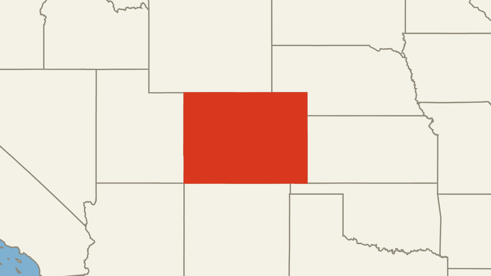
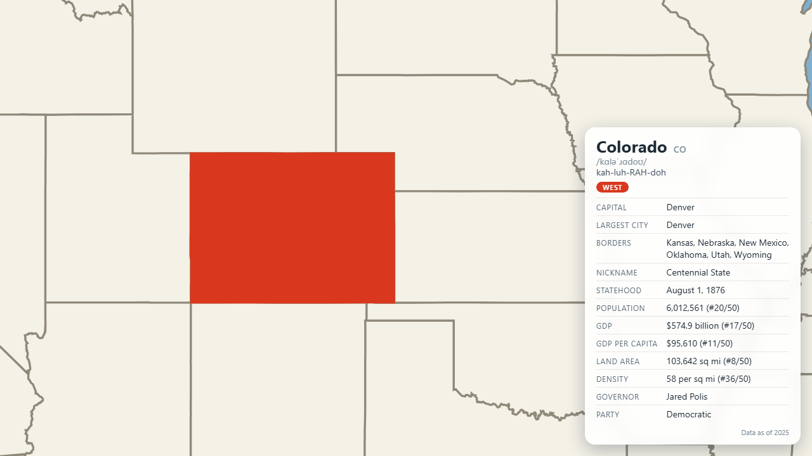
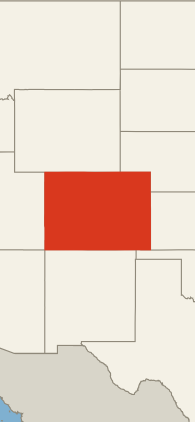
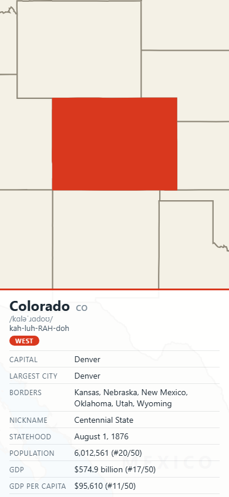

# 🌎 Studying the US Map

 <!-- x-release-please-version -->
  

**Learn where every U.S. state is, and a few facts about each one.**
50 states, one note each.

---

## Cards

### Map to State
Find the red state on a north-up map, then flip for the answer and its facts.

### On a phone
The cards fill the screen on a phone too: the map on top, and the details below it on the back.

---

## Maps
- **Sharp at any zoom:** every map is an SVG.
- **Real relative size:** each is a north-up view at a similar ground scale, with the state in red.
- **Small states stay findable:** Connecticut, Delaware and Rhode Island get a zoomed-in box in the top-left corner with a scale bar.
- **Fits every screen:** the map is scaled to fill the card on desktop and phone.

---

## What the back of the card shows
- **Name**, abbreviation and region
- **Pronunciation:** the IPA, with a plain-English respelling under it
- **Capital** and **largest city**
- **Borders**
- **Nickname** and **statehood date**
- **Governor** and party
- **Ranked numbers:** population, GDP, GDP per capita, land area and density

> Ranked values show the state's rank among the 50, like *6,012,561 (#20/50)*.

---

## Pronunciation
Each state shows how its name is said in US English, in two forms:

> **Wyoming**
>
> /waɪˈoʊmɪŋ/
>
> wy-OH-ming

In the respelling, hyphens separate the syllables and the stressed one is in capitals.

- **Vowels:** *a* cat, *ah* father, *air* care, *ar* start, *aw* thought, *ay* face, *e* bed, *ee* see, *eer* near, *er* nurse, *ai* price (written *y* after a consonant, as in *wy-OH-ming*), *i* kit, *oh* goat, *oo* goose, *oor* poor, *or* north, *ow* mouth, *oy* choice, *uh* strut, *uu* foot
- **Consonants:** *ch*, *j*, *sh*, *zh* (measure), *th* (thin), *dh* (this), *ng*, *y* (yes); the rest are as written

---

## Organisation
Four numbered sub-decks, one per Census region:

1. Northeast
2. South
3. Midwest
4. West

Within the deck, states are ordered by population, largest first.

---

## Accuracy
- Population and GDP are for 2025. Governors are those in office in November 2026, so check anything that matters.
- Names often have more than one accepted pronunciation; only one is shown, and the respelling is generated automatically.
- Borders are land borders only. States that meet at a single point or across water do not count.
- For the original 13 states, the statehood date is the date they ratified the Constitution.

---

## Sources
- **Shapes:** U.S. Census Bureau cartographic boundaries (via us-atlas) and Natural Earth.
- **Population:** U.S. Census Bureau.
- **GDP:** Bureau of Economic Analysis.
- **Pronunciation:** US English IPA from Wiktionary (CC BY-SA); the respelling is generated from it.
- **Capitals, largest cities, statehood, land area, governors and nicknames:** Wikipedia (CC BY-SA).

---

## Source code
The scripts and data that generate this deck: [jackindisguise/studying-the-us-map](https://github.com/jackindisguise/studying-the-us-map).
